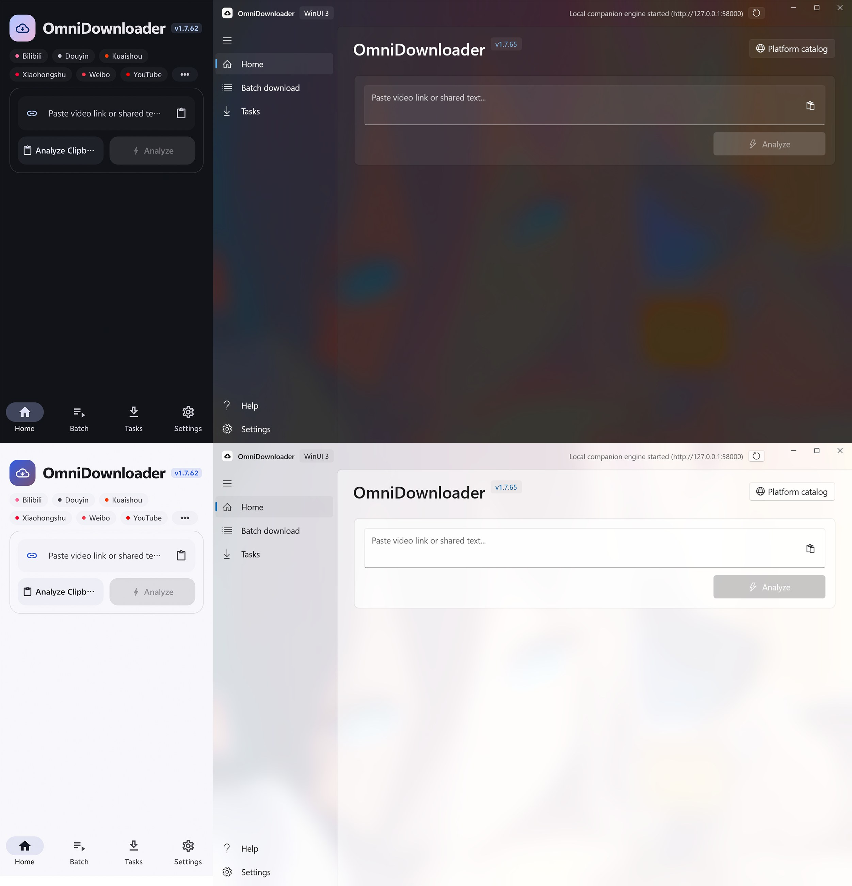

# OmniDownloader

  <a href="README.md">English</a> •
  <a href="README_ZH.md">简体中文</a> •
  <a href="README_ZH_TW.md">繁體中文</a> •
  <a href="README_JA.md">日本語</a>

  

**OmniDownloader** is a modern, cross-platform multimedia downloader matrix (**Android native, Apple iOS native, Windows WinUI 3 native desktop, and Web companion service**). It supports ultra-fast extraction and direct downloading of original-quality videos, audio, image galleries, and animated GIFs without watermarks from major platforms including **Bilibili (4K/1080P60 DASH muxing & playlists), Douyin, TikTok, Kuaishou, Xiaohongshu, YouTube, X (Twitter), Instagram, Facebook, and Pixiv**.

---

## 🌟 Cross-Platform Overview

| Platform | Target Devices | Core Tech Stack | Installation & Download |
| :--- | :--- | :--- | :--- |
| **🤖 Android Native** | Android Phones / Tablets / TV (Android 8.0+) | Kotlin + Jetpack Compose + yt-dlp + FFmpeg | [Download Latest APK](https://github.com/baishu136/OmniDownloader/releases/latest/download/OmniDownloader_LATEST.apk) · [All Releases](https://github.com/baishu136/OmniDownloader/releases) |
| **🍎 iOS Native** | iPhone / iPad (iOS 15.0+) | Swift 5.9 + SwiftUI + Native FFmpeg + Photos | [GitHub Releases](https://github.com/baishu136/OmniDownloader/releases) · [Sideload & Build Guide](OmniDownloader-iOS/README_IOS.md) |
| **💻 Windows Desktop (Unified)** | Windows 10 / 11 (64-bit) | .NET 8 WinUI 3 Fluent App + Python FastAPI + Built-in FFmpeg / Deno | [Latest Windows Portable Bundle](https://github.com/baishu136/OmniDownloader/releases/latest) · [WinUI 3 Docs](windows/winui3/README.md) |
| **🌐 Web Companion** | Windows PC, local browser | Lightweight Win32 tray daemon + FastAPI Web UI + Built-in FFmpeg | Included in Windows bundle or standalone Web archive on [Releases](https://github.com/baishu136/OmniDownloader/releases/latest) |

---

## 🚀 Key Features

1. **Multi-Platform Native Extraction**:
   - **Bilibili**: Full DASH stream muxing up to 4K / 1080P60, multi-part playlist batch downloading, built-in browser / Edge isolated sign-in, and persistent `SESSDATA` authentication.
   - **Short Video No-Watermark Extraction**: Direct official CDN streams from Douyin, Kuaishou, Xiaohongshu, and TikTok, plus original image sets and ZIP archiving.
   - **Global Media Platforms**: YouTube (4K / Shorts), X (Twitter, multi-video & HD image extraction), Instagram, Facebook, and Pixiv (including Ugoira frame archives & animations).
2. **Windows WinUI 3 Desktop & Theme-Synced Web Companion**:
   - **Unified Architecture & Customization**: Shared FastAPI core service powering both the native WinUI 3 client (`OmniDownloader_WinUI.exe`) and a clean Web UI (`OmniDownloader_Web.exe`) that automatically inherits client light/dark theme and custom accent colors.
   - **First-Run Onboarding & Category Routing**: Setup flow configures theme accent color, optional local Web Service switch, and separate default save folders (**Follow Default / Video / Images incl. GIF / Audio**).
   - **System Tray, Close Behavior & Component Management**: Native Win32 system tray right-click menu (`Show Window`, conditional `Open Web Version` hidden when Web Service is disabled, `Exit App`), persistent close behavior confirmation (`Minimize to Tray` / `Exit` + remember choice), clean subprocess shutdown when Web Service is disabled, built-in media players/viewers, Home recent-tasks visibility toggle, and extensible Component Management settings.
3. **Flexible Export & Transcoding Modes**:
   - Video + Audio (`MP4`), Video Only (mute track), High-fidelity Audio (`MP3` / `M4A` / `FLAC` / `OPUS`), bidirectional `GIF` ↔ `MP4` FFmpeg encoding with content validation, HDR outlines, and HD cover art saving.
4. **Collection Aggregation, Batch Queue & Full Localization**:
   - Batch URL parsing & TXT import, multi-episode collection cards with weighted progress drawers, browser media sniffer & relay parsing support, and full synchronization across **English, 简体中文, 繁體中文, and 日本語**.

---

## 📲 Quick Downloads

- **Android Latest APK**: [`OmniDownloader_LATEST.apk`](https://github.com/baishu136/OmniDownloader/releases/latest/download/OmniDownloader_LATEST.apk)
- **Windows Unified Desktop & Web**: Browse binaries & checksums on [GitHub Releases (Latest)](https://github.com/baishu136/OmniDownloader/releases/latest)
- **iOS Native Project & Sideload Guide**: See [`OmniDownloader-iOS/README_IOS.md`](OmniDownloader-iOS/README_IOS.md)
- **Complete Source Archive**: [`OmniDownloader_Source_LATEST.zip`](https://github.com/baishu136/OmniDownloader/releases/latest/download/OmniDownloader_Source_LATEST.zip)

---

## ☕ Sponsorship & Support

If you find this project helpful, feel free to buy the author a coffee! Your support is the greatest motivation to maintain and improve this project.

| 微信支付 (WeChat Pay) | 支付宝 (Alipay) |
| :---: | :---: |
|  |  |

---

## 📄 License
This project is licensed under the MIT License.
