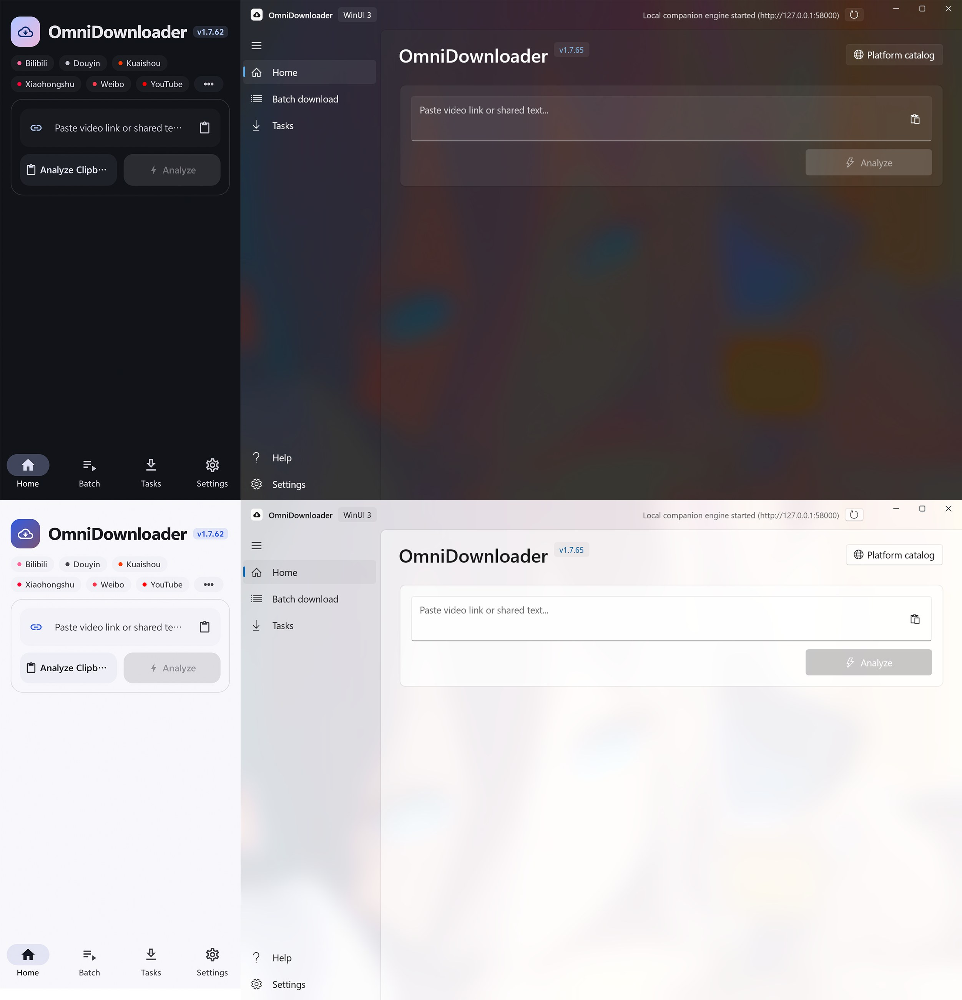

# OmniDownloader (万能メディアダウンローダー)

  <a href="README.md">English</a> •
  <a href="README_ZH.md">简体中文</a> •
  <a href="README_ZH_TW.md">繁體中文</a> •
  <a href="README_JA.md">日本語</a>

  

**OmniDownloader** は、クロスプラットフォームに対応した最新のマルチメディアダウンローダーです（**Android ネイティブ、Apple iOS ネイティブ、Windows WinUI 3 ネイティブデスクトップ、Web コンパニオン版**）。**Bilibili (4K/1080P60 DASH分離ストリーム合成/プレイリスト一括)、Douyin (抖音)、TikTok、Kuaishou (快手)、小紅書、YouTube、X (Twitter)、Instagram、Facebook、Pixiv** などの透かしなし高画質動画・音声・画像・GIF を高速に抽出・保存できます。

---

## 🌟 クロスプラットフォーム概要

| プラットフォーム | 対象デバイス | コア技術 | インストールと取得方法 |
| :--- | :--- | :--- | :--- |
| **🤖 Android 版** | Android スマートフォン / タブレット / TV (Android 8.0+) | Kotlin + Jetpack Compose + yt-dlp + FFmpeg | [最新 APK をダウンロード](https://github.com/baishu136/OmniDownloader/releases/latest/download/OmniDownloader_LATEST.apk) · [Releases](https://github.com/baishu136/OmniDownloader/releases) |
| **🍎 iOS 版** | iPhone / iPad (iOS 15.0+) | Swift 5.9 + SwiftUI + ネイティブ FFmpeg + 写真アプリ連携 | [Releases](https://github.com/baishu136/OmniDownloader/releases) · [iOS ビルド・署名ガイド](OmniDownloader-iOS/README_IOS.md) |
| **💻 Windows 統合デスクトップ版** | Windows 10 / 11 (64bit) | .NET 8 WinUI 3 Fluent クライアント + Python FastAPI + 内蔵 FFmpeg / Deno | [Latest Release](https://github.com/baishu136/OmniDownloader/releases/latest) から統合ポータブル版を展開してすぐ実行 |
| **🌐 Web コンパニオン版** | Windows PC のローカルブラウザ | 軽量 Win32 タスクトレイ常駐 + FastAPI Web UI + 内蔵 FFmpeg | 統合版に同梱、または [Latest Release](https://github.com/baishu136/OmniDownloader/releases/latest) の Web 単体版を利用 |

---

## 🚀 主な機能と特徴

1. **主要メディアプラットフォーム完全対応**：
   - **Bilibili**：単話・複数パート・合集の一括認識に対応し、4K/1080P60 DASH 映像・音声合成、内蔵ブラウザログインおよび `SESSDATA` 認証をサポート。
   - **ショート動画・画像直連抽出**：Douyin (抖音)、Kuaishou (快手)、小紅書、TikTok の透かしなし動画および高画質画像セット／ZIP 保存に対応。
   - **グローバルプラットフォーム対応**：YouTube (4K / Shorts)、X (Twitter 複数動画・高画質画像)、Instagram、Facebook、Pixiv (Ugoira 動画・フレーム含む) をカバー。
2. **WinUI 3 ネイティブ体験・オンボーディング・トレイ制御**：
   - カスタムテーマアクセントカラー設定に対応し、Web コンパニオン画面もクライアント配色と連動。
   - 初回起動ガイドでテーマ色、Web サービスの有効・無効、種別ごとの保存フォルダ（デフォルトに追従／動画／画像・GIF／音声）を設定可能。
   - 終了確認ダイアログ（選択を記憶）、Win32 タスクトレイ右クリックメニュー（「ウィンドウを表示」「Web 版を開く」※無効時は非表示、「終了」）、Web サービス無効時の関連プロセス完全終了、拡張可能なコンポーネント管理、内蔵メディアプレーヤー／ビューア、ホーム画面の「最近のタスク」表示切替を搭載。
3. **多彩な出力・変換モード**：
   - 映像＋音声 (`MP4`)、映像のみ (無音)、高音質音声抽出 (`MP3` / `M4A` / `FLAC` / `OPUS`)、双方向 `GIF` ↔ `MP4` FFmpeg 変換と検証、HDR 枠表示、HD カバー画像保存に対応。
4. **スマート一括ダウンロード & 4言語完全サポート**：
   - バッチ URL 解析・TXT 読込、重み付け進捗＆エピソード展開カードを備え、**日本語、English、简体中文、繁體中文** の 4 言語に対応。

---

## 📲 クイックダウンロード

- **Android 最新版 APK**：[`OmniDownloader_LATEST.apk`](https://github.com/baishu136/OmniDownloader/releases/latest/download/OmniDownloader_LATEST.apk)
- **Windows 統合版 / Web 版**：[GitHub Latest Release](https://github.com/baishu136/OmniDownloader/releases/latest) より取得
- **iOS サイドロードガイド**：[`OmniDownloader-iOS/README_IOS.md`](OmniDownloader-iOS/README_IOS.md) を参照
- **完全ソースコードアーカイブ**：[`OmniDownloader_Source_LATEST.zip`](https://github.com/baishu136/OmniDownloader/releases/latest/download/OmniDownloader_Source_LATEST.zip)

---

## ☕ スポンサー・支援

本プロジェクトがお役に立ちましたら、作者へのコーヒー一杯のご支援をいただければ幸いです。皆様のご支援が継続的なメンテナンスと機能向上の原動力になります。

| 微信支付 (WeChat Pay) | 支付宝 (Alipay) |
| :---: | :---: |
|  |  |

---

## 📄 ライセンス
本プロジェクトは MIT ライセンスの下で公開されています。
