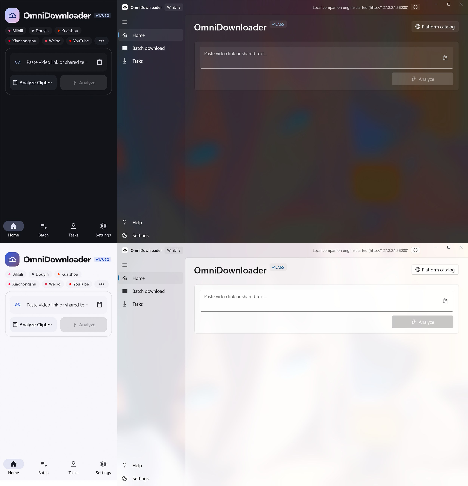

# OmniDownloader (全能音视频下载器)

  <a href="README.md">English</a> •
  <a href="README_ZH.md">简体中文</a> •
  <a href="README_ZH_TW.md">繁體中文</a> •
  <a href="README_JA.md">日本語</a>

  

**OmniDownloader** 是一套现代化全平台多媒体音视频下载矩阵（涵盖 **Android 原生、Apple iOS 原生、Windows WinUI 3 原生桌面版、Web 网页配套后台版**）。支持 **哔哩哔哩 (4K/1080P60/DASH分离流/合集聚合)、抖音、快手、小红书、TikTok、YouTube、X (Twitter)、Instagram、Facebook、Pixiv** 等各大主流平台原画无水印音视频、图文及动图的高速提取与下载。

---

## 🌟 全平台产品形态一览

| 平台形态 | 适用设备 | 核心技术栈 | 获取与安装方式 |
| :--- | :--- | :--- | :--- |
| **🤖 Android 原生版** | Android 手机 / 平板 / 车机 / 电视 (Android 8.0+) | Kotlin + Jetpack Compose + yt-dlp + FFmpeg | [下载最新 APK](https://github.com/baishu136/OmniDownloader/releases/latest/download/OmniDownloader_LATEST.apk) · [Releases 页面](https://github.com/baishu136/OmniDownloader/releases) |
| **🍎 iOS 原生版** | iPhone / iPad (iOS 15.0+) | Swift 5.9 + SwiftUI + 原生 FFmpeg + Photos 相簿 | [Releases 页面](https://github.com/baishu136/OmniDownloader/releases) · [iOS 编译与侧载指南](OmniDownloader-iOS/README_IOS.md) |
| **💻 Windows 桌面整合版** | Windows 10 / 11 (64位) | .NET 8 WinUI 3 Fluent 原生客户端 + Python FastAPI + 内置 FFmpeg / Deno | 前往 [Latest Release](https://github.com/baishu136/OmniDownloader/releases/latest) 下载便携整合包，解压即用 |
| **🌐 Web 网页配套后台版** | Windows 本机浏览器 | 轻量 Win32 系统托盘进程 + FastAPI Web 服务 + 内置 FFmpeg | 整合包内置或前往 [Latest Release](https://github.com/baishu136/OmniDownloader/releases/latest) 下载独立后台包 |

---

## 🚀 核心特性

### 1. 🌐 主流音视频与图文平台原生全支持
- **哔哩哔哩 (Bilibili)**：
  - 支持单视频、多 P 分集与番剧/UGC 合集批量识别；
  - 原生 DASH 双流解耦与自适应优选算法（支持 4K/1080P60 极清画质与 AVC/HEVC/AV1 编码筛选）；
  - 支持内置浏览器及独立会话隔离登录，安全持久化 `SESSDATA` 凭证以获取对应会员/高画质权益。
- **国内短视频与图文直连**：
  - **抖音 (Douyin)**：支持分享口令与短链解析，自动提取原画无水印直链与图文合集；
  - **快手 (Kuaishou)**：短视频与图文无水印提取；
  - **小红书 (Xiaohongshu)**：无水印原图抓取、笔记打包与高清视频下载。
- **国际主流媒体全覆盖**：
  - **YouTube**：支持 4K/2K/1080P 超高清流与 Shorts 短视频；
  - **TikTok**：无水印原画视频与图文抓取；
  - **X (Twitter) / Instagram / Facebook / Pixiv**：支持多视频/高清图文、Ugoira 动图导出，并提供按平台隔离的浏览器会话及 Netscape Cookie 管理。

### 2. 🎨 WinUI 3 原生交互、首次引导与托盘生命周期控制
- **自定义主题配色与网页视觉同步**：支持在设置内自由选择主题强调色与深浅外观，配套网页版采用清爽分区布局并实时跟随客户端主题色变化。
- **首次使用引导与分类目录保存**：首次运行引导可便捷配置主题色、网页服务开关，以及「跟随默认目录 / 视频保存目录 / 图片保存目录（含 GIF）/ 音频保存目录」。
- **关闭确认与系统托盘菜单**：关闭主窗口时支持弹窗确认（关闭退出 / 最小化到托盘 / 取消 + 始终保存选择）；Win32 系统托盘右键菜单提供「显示窗口」「拉起网页版（未开启网页服务时自动隐藏）」「退出程序」；未开启网页服务时退出软件将彻底结束全部分支后台与组件进程。
- **组件管理与内置播放器**：提供简洁可扩展的组件管理界面（核心必需组件锁定防误删）；客户端内置原生视频播放器与图片查看器，支持 HDR 流金色轮廓标记与首页「最近任务」展示开关。

### 3. 🎬 丰富的导出与转码模式
- **音画合流 (`MP4`)**：自由选择目标清晰度与封装容器，毫秒级无损合并音视频轨道。
- **仅纯视频画面**：自动剥离音轨生成无声纯净视频，方便视频剪辑与二创。
- **高保真音频提取**：支持提取或转码为 **`MP3`**、**`M4A`**、**`FLAC` 无损**、**`OPUS`**。
- **动态图 (`GIF`) 与视频互转**：支持真实的 `GIF` ↔ `MP4` 双向 FFmpeg 调色板编码与文件格式完整性校验。
- **保存高清封面**：支持单独保存原图封面或下载视频时伴随保存封面。

### 4. 📦 智能合集聚合、批量任务与四语种国际化
- **批量解析与合集卡片**：支持多链接粘贴、TXT 导入及自动去重；下载多视频或合集时合并展示加权总进度条与平滑展开的分集抽屉，并内置网页媒体嗅探与中转解析能力。
- **全链路 4 语种支持**：全平台界面及说明完整支持 **简体中文、繁體中文、English、日本語**。

---

## 📲 快速下载安装

- **Android 最新安装包**：[`OmniDownloader_LATEST.apk`](https://github.com/baishu136/OmniDownloader/releases/latest/download/OmniDownloader_LATEST.apk)
- **Windows 整合版 & 网页后台版**：前往 [GitHub Latest Release](https://github.com/baishu136/OmniDownloader/releases/latest) 下载对应压缩包与 `SHA256SUMS.txt` 校验文件（Windows 端使用说明见 [`windows/README.md`](windows/README.md) 与 [`windows/winui3/README.md`](windows/winui3/README.md)）
- **iOS 原生工程与打包**：源码位于 [`OmniDownloader-iOS/`](OmniDownloader-iOS/)，安装与签名方法参见 [iOS 侧载安装指南](OmniDownloader-iOS/README_IOS.md)
- **完整工程源码归档**：[`OmniDownloader_Source_LATEST.zip`](https://github.com/baishu136/OmniDownloader/releases/latest/download/OmniDownloader_Source_LATEST.zip)

---

## ☕ 赞助与支持

如果您觉得本项目对您有所帮助，欢迎赞助支持作者！您的支持是持续维护与迭代的最大动力。

| 微信支付 (WeChat Pay) | 支付宝 (Alipay) |
| :---: | :---: |
|  |  |

---

## 📄 授权与免责声明
本项目仅供编程学习与个人影音离线归档使用，解析下载音视频之著作权归各平台及原作者所有。遵循 MIT 开源许可协议。
