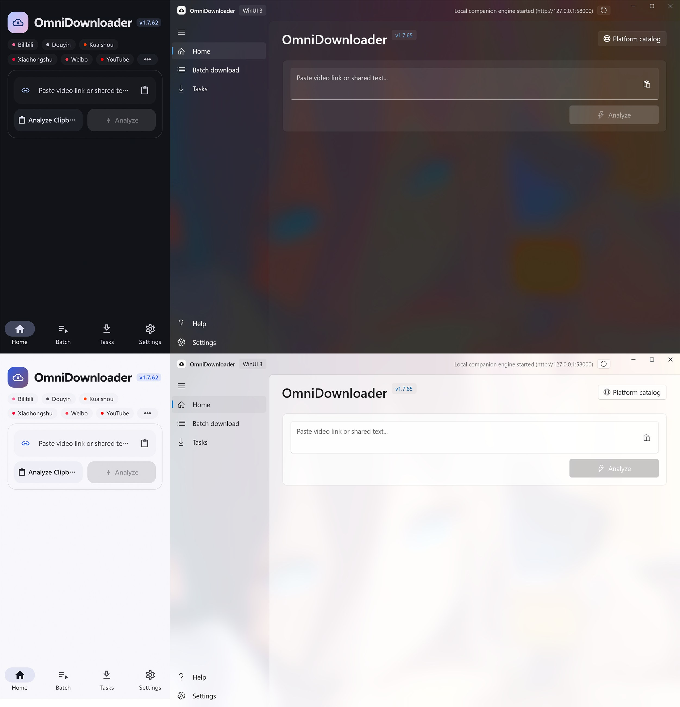

# OmniDownloader (全能影音下載器)

  <a href="README.md">English</a> •
  <a href="README_ZH.md">简体中文</a> •
  <a href="README_ZH_TW.md">繁體中文</a> •
  <a href="README_JA.md">日本語</a>

  

**OmniDownloader** 是一套現代化全平台多媒體影音下載矩陣（涵蓋 **Android 原生、Apple iOS 原生、Windows WinUI 3 原生桌面版、Web 網頁配套後台版**）。支援 **Bilibili (4K/1080P60/DASH分離流/合輯聚合)、抖音、快手、小紅書、TikTok、YouTube、X (Twitter)、Instagram、Facebook、Pixiv** 等各大主流平台原畫無浮水印影音、圖文與動圖的極速提取與下載。

---

## 🌟 全平台產品型態一覽

| 平台型態 | 適用裝置 | 核心技術棧 | 取得與安裝方式 |
| :--- | :--- | :--- | :--- |
| **🤖 Android 原生版** | Android 手機 / 平板 / 電視盒 (Android 8.0+) | Kotlin + Jetpack Compose + yt-dlp + FFmpeg | [下載最新 APK](https://github.com/baishu136/OmniDownloader/releases/latest/download/OmniDownloader_LATEST.apk) · [Releases 頁面](https://github.com/baishu136/OmniDownloader/releases) |
| **🍎 iOS 原生版** | iPhone / iPad (iOS 15.0+) | Swift 5.9 + SwiftUI + 原生 FFmpeg + Photos 相簿 | [Releases 頁面](https://github.com/baishu136/OmniDownloader/releases) · [iOS 編譯與側載指南](OmniDownloader-iOS/README_IOS.md) |
| **💻 Windows 桌面整合版** | Windows 10 / 11 (64位元) | .NET 8 WinUI 3 Fluent 用戶端 + Python FastAPI + 內建 FFmpeg / Deno | 前往 [Latest Release](https://github.com/baishu136/OmniDownloader/releases/latest) 下載便攜整合包，解壓即用 |
| **🌐 Web 網頁配套後台版** | Windows 本機瀏覽器 | 輕量 Win32 系統列托盤常駐 + FastAPI Web 服務 + 內建 FFmpeg | 整合包內建或前往 [Latest Release](https://github.com/baishu136/OmniDownloader/releases/latest) 下載獨立後台包 |

---

## 🚀 核心特性

1. **主流影音與圖文平台原生全支援**：
   - **Bilibili**：支援單集、多P分集與番劇/UGC合輯；原生 DASH 雙流解耦，支援 4K/1080P60 畫質、內建瀏覽器登入與 `SESSDATA` 授權憑證。
   - **短影音與圖文直連**：抖音、快手、小紅書、TikTok 短鏈嗅探與自動重新導向，提取官方 CDN 原畫無浮水印直鏈與原圖壓縮包。
   - **國際主流媒體全覆蓋**：YouTube (4K/Shorts)、X (Twitter)、Instagram、Facebook、Pixiv（含 Ugoira 動圖導出）及隔離 Cookie 工作階段管理。
2. **WinUI 3 原生互動、首次引導與系統列控制**：
   - 支援自訂主題強調色，配套網頁版自動同步用戶端主題與配色；首次啟動引導支援分類儲存目錄（跟隨預設 / 影片 / 圖片含 GIF / 音訊）與網頁服務開關。
   - 關閉視窗確認（關閉 / 最小化到系統列 / 取消 + 記住選擇）、Win32 系統列托盤選單（顯示視窗 / 拉起網頁版 / 結束程式）、可擴充的元件管理介面、內建原生播放器與首頁「最近任務」顯示開關。
3. **多樣化導出與轉碼模式**：
   - 音畫合流 (`MP4`)、純視訊畫面、高保真音訊提取 (`MP3` / `M4A` / `FLAC` / `OPUS`)、真實 `GIF` ↔ `MP4` 雙向轉碼、HDR 金色輪廓標記與高畫質封面圖。
4. **智慧合輯聚合卡片與多國語言支援**：
   - 支援批次連結匯入、加權總進度條與展開分集抽屜，介面全面支援 **繁體中文、簡體中文、English、日本語**。

---

## 📲 快速下載安裝

- **Android 最新版**：[`OmniDownloader_LATEST.apk`](https://github.com/baishu136/OmniDownloader/releases/latest/download/OmniDownloader_LATEST.apk)
- **Windows 整合包與獨立 Web 版**：前往 [GitHub Latest Release](https://github.com/baishu136/OmniDownloader/releases/latest) 下載對應壓縮包與 `SHA256SUMS.txt`
- **iOS 側載與建置指南**：參考 [`OmniDownloader-iOS/README_IOS.md`](OmniDownloader-iOS/README_IOS.md)
- **完整原始碼壓縮檔**：[`OmniDownloader_Source_LATEST.zip`](https://github.com/baishu136/OmniDownloader/releases/latest/download/OmniDownloader_Source_LATEST.zip)

---

## ☕ 贊助與支持

如果您覺得本專案對您有所幫助，歡迎贊助支持作者！您的支持是持續維護與更新的最大動力。

| 微信支付 (WeChat Pay) | 支付寶 (Alipay) |
| :---: | :---: |
|  |  |

---

## 📄 授權協議
本專案遵循 MIT 開源許可協議。
